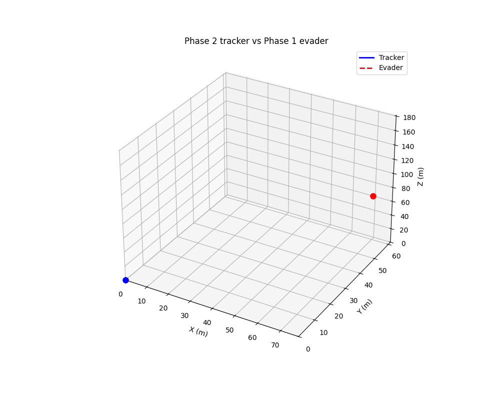

# 3D Co-evolutionary Pursuit-Evasion with ADHDP / DDPG

A tracker and an evader, each a small actor-critic network (6-dimensional state, 2-dimensional action, two hidden layers of 64 units; PyTorch, DDPG-style ADHDP), are trained against each other in a custom Gymnasium pursuit-evasion environment. Training alternates in four phases: tracker against a straight-flying evader, evader against that tracker, tracker against that evader, evader against that tracker.

AE4350 Bio-inspired Intelligence and Learning for Aerospace Applications, TU Delft. Course project by Duarte Fernandes.

## Result

The arms race works in the sense that each retrained side beats the previous opponent: the tracker's capture rate falls from 56% to 40% once the evader has learned to dodge, recovers to 56% after the tracker is retrained, and falls to 34% after the evader is retrained (greedy policies, 50 evaluation episodes per matchup).

<p align="center"></p>

*Phase 2 tracker (blue) against the Phase 1 evader (red). This is the shortest capture of the 50 evaluation episodes, not a typical one: this matchup ends in a capture in 28 of 50 episodes. Capture rate by phase as a bar chart: [`figures/arms_race.png`](figures/arms_race.png). The other two animations are in `figures/`.*

**It is not a robust result.** The numbers above come from one training run. In the sensitivity sweep, three training seeds with identical settings give cross-phase capture rates anywhere between 10% and 80%. Raising the evader's maximum speed from the default 8 to 10 or 12 drops every matchup to at most 24% capture (speed 10) and at most 2% (speed 12). The sweep (evader speed, discount factor, capture radius) is in `sensitivity/`; the PPO baseline and the intermediate versions are kept in `old_experiments/` and `dev_history/`.

## How to run

```bash
pip install -r requirements.txt

# Full training (~2–3 h on CPU)
python project_pipeline.py

# Regenerate evaluation figures from saved models (fast)
python regen_eval_table.py

# Sensitivity analysis (~8 h on CPU)
python project_sensitivity.py
```

## Structure

```
project_pipeline.py       main pipeline: environment, DDPG agent, 4-phase co-evolutionary training
project_sensitivity.py    parameter sweep (evader speed, discount factor, capture radius)
regen_eval_table.py       reload saved models and regenerate evaluation figures

models/                   trained actor weights for all four phases
figures/                  all output figures and animations
sensitivity/              sweep results (results.json) and plots
dev_history/              numbered scripts showing the development progression
old_experiments/          earlier experiments (PPO baseline, intermediate versions)
```
